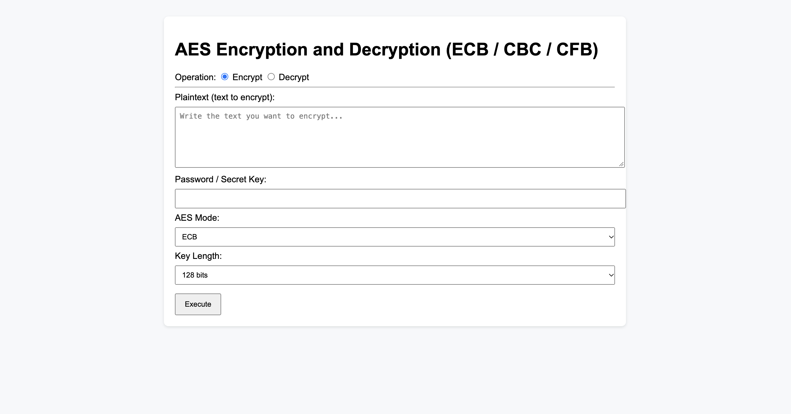
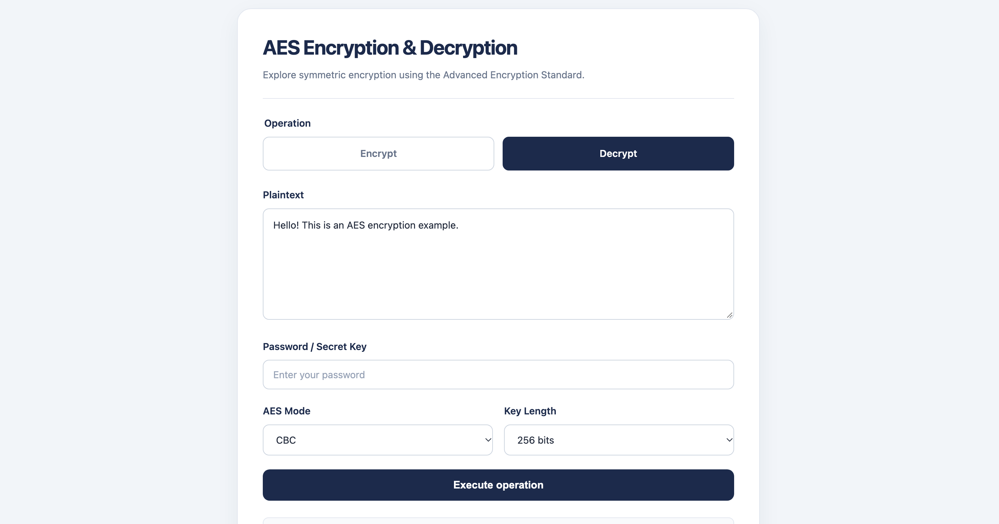
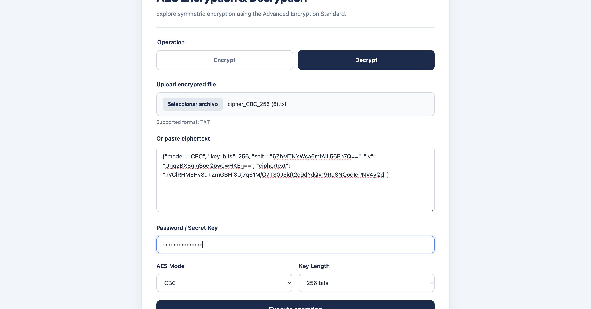

# AES Encryption & Decryption Web App


## Overview

A web application developed with Python and Flask that allows users to encrypt and decrypt text using the Advanced Encryption Standard (AES).

This project was developed as part of my academic studies at the University of Vigo to explore symmetric cryptography, data protection and web application development.

## Features

- Text encryption and decryption using AES.
- Support for ECB, CBC and CFB encryption modes.
- Support for 128-bit, 192-bit and 256-bit keys.
- Password-based encryption and decryption.
- Download encrypted content as a TXT file.
- Decrypt content by uploading a file or pasting encrypted text.
- Web-based user interface.

## Application Demo

### User Interface



### Encryption Example

Text encryption configuration using CBC mode and a 256-bit key.



### Decryption Result

Successful recovery of the original plaintext.




## Technologies

| Technology | Purpose |
|---|---|
| Python | Backend logic |
| Flask | Web framework |
| Cryptography | Encryption and decryption |
| HTML and CSS | User interface |
| JSON | Encrypted data structure |

## Project Structure

    aes-encryption-app/
    ├── app.py
    ├── utils/
    ├── templates/
    ├── static/
    ├── requirements.txt
    ├── .gitignore
    └── README.md

## Installation

### 1. Clone the repository

```bash
git clone https://github.com/rosaliarivera/aes-encryption-app.git
cd aes-encryption-app
```

### 2. Create a virtual environment

```bash
python3 -m venv venv
source venv/bin/activate
```

For Windows:

```bash
venv\Scripts\activate
```

### 3. Install dependencies

```bash
pip install -r requirements.txt
```

### 4. Run the application

```bash
python app.py
```

Open your browser and navigate to:

http://127.0.0.1:5000

## How It Works

### Encryption

1. Enter the text you want to encrypt.
2. Select the encryption mode and key size.
3. Enter a password.
4. Download the encrypted TXT file.

### Decryption

1. Select the decryption option.
2. Upload the encrypted file or paste its content.
3. Enter the original password.
4. Retrieve the decrypted text.

## Learning Objectives

- Understanding symmetric encryption and AES.
- Exploring different encryption modes.
- Working with Python cryptographic libraries.
- Developing web applications with Flask.
- Understanding basic information security concepts.

## Security Notice

This application was developed for educational purposes.
It is not intended for production use or the protection
of sensitive information. ECB mode is included for
educational comparison and is not recommended for
real-world applications.

